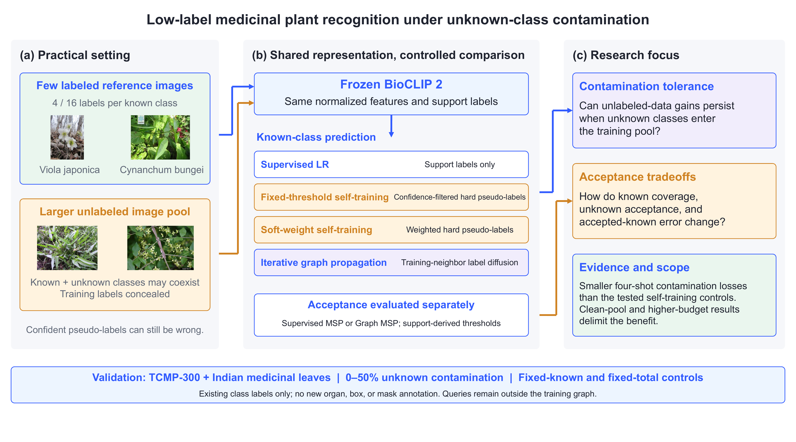
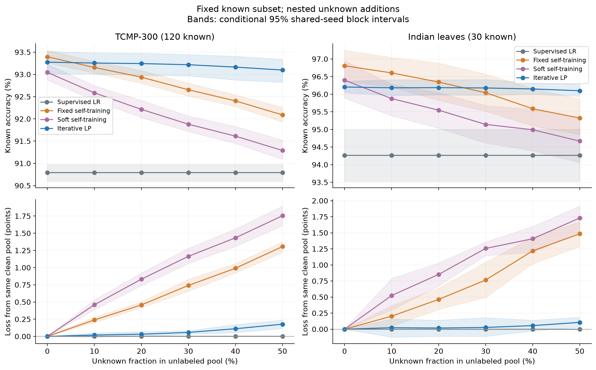

# Low-label medicinal plant recognition under unknown-class contamination

[中文说明](README_zh.md) · [Protocol](docs/PROTOCOL.md) · [Data](data/README.md) · [Validation](docs/VALIDATION.md)

Reproduction materials for **Low-Label Medicinal Plant Recognition with Frozen Biological Representations: Unknown-Class Contamination Tolerance and Acceptance Tradeoffs**.

The study compares supervised logistic regression (LR), fixed/soft self-training, and iterative label propagation (LP) on frozen BioCLIP 2 features. It evaluates known-class recognition separately from support-calibrated acceptance, using existing species/folder labels without new organ, box, or mask annotations.



TCMP-300 example photographs in the overview are attributed to Zhang et al., Figshare TCMP-300 (CC BY 4.0); they illustrate data roles.



## What is included

- Locked TCMP evaluation manifests: 240 classes, 29,050 training and 11,993 query images; nested four-/sixteen-shot support draws and three open-class roles.
- Locked Indian medicinal leaf subset: 60 classes, 3,955 training and 988 query images, similarity grouping records and the same evaluation rules.
- All 336 saved fixed-known/fixed-total pool index sets; 350 per-context dual-source results (seven classifiers × three acceptance rules), 476 original TCMP per-method results, and available review-control metadata.
- Core learning/evaluation code, portable extraction/running commands, source provenance, analysis scripts, numerical reference outputs, citations, and file checksums.

Images, model weights, extracted features, fitted estimator caches and large probability arrays are downloaded or regenerated separately. Dataset download and attribution information is in [data/README.md](data/README.md).

## 1. Install

Run commands from this repository root. Python 3.10–3.12 is supported by the declared dependency range; Python 3.10 is appropriate for the inspected reference environment.

```bash
python -m venv .venv
# Linux/macOS: source .venv/bin/activate
# Windows PowerShell: .venv\Scripts\Activate.ps1
python -m pip install -e .
```

The portable package pins scikit-learn 1.7.2 and constrains NumPy/SciPy to retain the original implementation interfaces. See [environment notes](environment/README.md) for the distinction between inspected versions and a full historical lockfile.

## 2. Reproduce analyses without a GPU or raw images

```bash
python scripts/verify_release.py
python scripts/smoke_test.py
python scripts/analyze_formal.py
python scripts/analyze_results.py --input results/reference --output outputs/analysis
python scripts/compare_analysis.py
```

This checks split integrity and exact context indices, exercises all seven classifiers/three gates on synthetic features, and regenerates the dual-source contamination, ablation, acceptance and pseudo-label analyses. Outputs appear under `outputs/analysis`. The comparison checks all numerical entries against the released reference statistics. Original TCMP closed/full-pool values are additionally in `results/reference/formal/`.

## 3. Re-run from images

Obtain and unpack the two datasets as documented in [data/README.md](data/README.md). First audit the exact image identities:

```bash
python scripts/verify_images.py --dataset tcmp --data-root /path/to/tcmp-300
python scripts/verify_images.py --dataset indian --data-root "/path/to/Medicinal Leaf dataset"
```

Image roots must contain the relative paths recorded in the manifests. The strict SHA-256 check identifies archive/file differences before computation; mismatched data should be reported rather than silently replacing the study split.

For the reference GPU stack, install PyTorch 2.7.1 and torchvision 0.22.1 with CUDA 11.8 using the official PyTorch wheel index, then the feature dependencies:

```bash
python -m pip install torch==2.7.1 torchvision==0.22.1 --index-url https://download.pytorch.org/whl/cu118
python -m pip install -e ".[features]"
python scripts/download_checkpoint.py --output checkpoints/bioclip-2
# Optional network route:
# python scripts/download_checkpoint.py --output checkpoints/bioclip-2 --endpoint https://hf-mirror.com
python -m tcmp_repro.extract --dataset tcmp --data-root /path/to/tcmp-300 --model-dir checkpoints/bioclip-2 --output outputs/features/tcmp --device cuda:0 --batch-size 4
python -m tcmp_repro.extract --dataset indian --data-root "/path/to/Medicinal Leaf dataset" --model-dir checkpoints/bioclip-2 --output outputs/features/indian --device cuda:0 --batch-size 2
```

Checkpoint revision and weight hash are checked against `provenance/model.json`. Extraction uses only the frozen visual encoder, EXIF correction, RGB conversion, bicubic short-side resize to 224, center crop, the checkpoint mean/SD, float32 inference and L2 normalization. CPU extraction is available with `--device cpu`; the original hardware was an NVIDIA Tesla P40 24 GB. CPU, GPU, numerical-library versions and batch shapes can cause small floating-point differences.

Run a limited gradient context first, then the full suites:

```bash
python -m tcmp_repro.run --dataset tcmp --features outputs/features/tcmp/features.npy --ids outputs/features/tcmp/ids.json --output outputs/pilot/tcmp --suite gradients --seed 4001 --role 202610130 --rho 0.5 --max-contexts 1
python -m tcmp_repro.run --dataset tcmp --features outputs/features/tcmp/features.npy --ids outputs/features/tcmp/ids.json --output outputs/rerun/tcmp --suite gradients
python -m tcmp_repro.run --dataset indian --features outputs/features/indian/features.npy --ids outputs/features/indian/ids.json --output outputs/rerun/indian --suite all
python -m tcmp_repro.original --features outputs/features/tcmp/features.npy --ids outputs/features/tcmp/ids.json --output outputs/original_tcmp
```

The original TCMP command runs its 14 closed and 105 open contexts, each with four methods (476 result records), using Clean-full, Add10, Add30, Matched30 and Clean-thin pools. The dual-source runner reproduces 168 TCMP open contexts and 182 Indian closed/open contexts. The two pool families have different clean baselines; see [protocol](docs/PROTOCOL.md). Use a separate output directory for a pilot so a subsequent full run has an unambiguous scope. To analyze new dual-source runs, pass `--input outputs/rerun` to the analysis script; it requires complete suites.

All classification/graph fitting runs on CPU. GPU use is for feature extraction. Estimator and graph caches resume completed work; do not reuse an output directory after changing code or inputs.

## Interpretation and reproducibility status

Primary evidence concerns four-shot contamination tolerance, not universal superiority or a new graph algorithm. Clean-pool/sixteen-shot outcomes and class-tail summaries are part of the release. Thresholds are fitted from support-only predictions; query-label-derived risk–coverage curves are retrospective evaluation curves, not deployed threshold calibration. See [protocol](docs/PROTOCOL.md).

The release has been checked through metadata/index validation, synthetic integration, core-source comparisons, and saved-result reanalysis. The new portable feature/download wrappers have not been independently exercised end-to-end from fresh dataset downloads; a fresh full GPU reproduction is not claimed. Validation details are recorded in [docs/VALIDATION.md](docs/VALIDATION.md).

## Citation and licenses

Please cite the study using its eventual publication metadata, and cite the dataset/model papers in `references.bib`. `CITATION.cff` identifies this software release and its authors (Jingyi Hu, Peihua Zhang, Xiangmeng Li, Zibin Wang); add the publication DOI when available. Project code is MIT licensed. Original data/model licenses and attribution remain separate; see [THIRD_PARTY_NOTICES.md](THIRD_PARTY_NOTICES.md).
